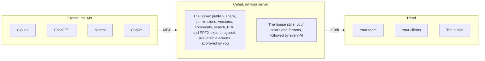

# Cahut

**The home for everything your AIs make.**

Documents, slide decks, dashboards and small apps live online as living pages, in your house style, on your own server, whichever AI made them.

Cahut installs with one command on a Linux server. Claude, ChatGPT, Mistral or Copilot publish to it over MCP, and you share a link instead of sending a file. The AI does on its own what can be undone, a human approves the rest, and every action is logged.

> [!WARNING]
> Cahut is in early development. Nothing is usable yet, and everything below describes the target for the public launch.

## Why Cahut

The file is going away. Word, PowerPoint and Excel were designed for humans who write, lay out and calculate by hand. When an AI produces the content, it naturally produces living pages, each with its own address. You no longer send an attachment, you share a link: the page updates, takes comments, keeps its versions, and exports to PDF or PowerPoint for whoever still needs a file.

Today, what AIs make has no home:

- **Scattered**: a Claude link here, a ChatGPT link there, a Gamma deck somewhere else. Each AI keeps what it makes on its own service.
- **Converted back**: for lack of anything better, the result is turned back into a PowerPoint or a Word file so it can be shared and filed.
- **Uncontrolled**: who has access, until when, which version is the right one, where the data lives. Nobody really knows.
- **Inconsistent**: every AI has its own style, and the organization's brand gets lost.
- **Unguarded**: handing a server to an AI means giving it a root shell, or going through a platform built for humans that it can barely use.

**Your AIs make it, Cahut keeps it alive.** Everything they produce is published, shared, organized and protected in one place, in your colors, on your server, whatever the AI.

Cahut does not create content, it hosts it. It does not compete with AIs or creation tools: it is the neutral, self-hosted home where their work lives.

| Layer | Who handles it | What it brings |
| --- | --- | --- |
| Create | The AIs (Claude, ChatGPT, Mistral, Copilot...) | The content: documents, decks, dashboards, apps |
| Keep and share | Cahut, on your server | Publishing, links, permissions, versions, comments, search, export, logbook |
| Look and feel | The house style, carried by Cahut | Your colors and formats, given to every AI as templates and skills |

## How it works

The AIs stay outside. They connect to Cahut over MCP, drop their work through bounded operations, then disconnect. No AI model runs on the server.



1. **Connect.** Add Cahut to your AI (MCP connector and skill) and authorize it once with OAuth, with the scope you choose.
2. **Create.** Ask your AI for a document, a deck, a dashboard or an app. The skill gives it your formats and house style.
3. **Publish.** The AI publishes to a Room, declares what the publication does, and gets an address back. The previous version is kept.
4. **Share.** You, or the AI within the limits you set, choose who gets in: public, password, internal or invited guests. Anything irreversible waits for approval in the console.
5. **Live.** Readers open the page in a browser and comment on it. The AI updates it on request. Everything goes to the logbook.

## Features

The full scope ships at launch, with no reduced trial version.

| Area | At launch |
| --- | --- |
| Installation | One command on a fresh VPS or dedicated server (AlmaLinux or Ubuntu), guided first start, linking of the admin and their first AI |
| AI access | Native MCP server (HTTP, OAuth), one skill per AI client packaged as a plugin where the client allows it, Claude first then ChatGPT, Mistral, Copilot and others, SSH access limited to the same operations for terminal AIs |
| Pages | Documents, decks, dashboards and static sites, each at its own address |
| Apps | Predefined runtimes (Node, Python...) and an advanced Dockerfile mode, variables and secrets, PostgreSQL or SQLite databases, runtime logs, resource limits |
| Sharing | By link: public, password, internal (instance members) or guests invited by email, with an adjustable lifetime |
| Versions | Two versions kept per publication, roll back in one gesture |
| Comments | Reader feedback directly on the pages |
| Search | Find any page, deck or dashboard across everything published |
| Export | PDF and PowerPoint, for recipients still on Office |
| House style | The organization's colors, fonts, logos and templates, given to every AI so everything comes out on brand |
| Users and Rooms | Admin, users, personal and team Rooms, owners and members |
| Web console | See what is published, share, comment, approve irreversible actions, administer the instance |
| Domains and TLS | A domain or a wildcard, automatic certificates, fallback address without a domain |
| Logbook | History of every action: who, which AI, on whose behalf, with what result |
| Backups | Optional, to external S3 or SFTP storage, restore from the console |
| Updates | Automatic, checked against the releases published on GitHub, with rollback |

What Cahut does **not** do:

- Create content: that is the AIs' job.
- Run an AI model on the server: the AIs stay outside and connect to it.
- Depend on one AI vendor, or lock work into a proprietary format.
- Give an AI free access to the server.
- Run across several machines: one instance, one machine.

## Governance: knock first

The AI is the intended operator of Cahut, but never without guardrails.

1. **Bounded operations.** The AI acts through typed operations (publish a page, create a database, share a link), never through a free shell, over MCP as over SSH.
2. **Reversible or approved.** What can be undone, the AI does alone. What cannot waits for a human to approve it in the console, with a notification and an expiry.
3. **The AI declares what it publishes.** Each publication states what it contains and what it does (an app that collects data, calls out, opens a form).
4. **Per-agent permissions.** Each AI acts on behalf of a person, with the scope that person grants, revocable at any time.
5. **Everything is logged.** Which AI, on whose behalf, which action, which result: the logbook is readable in the console.
6. **Data stays home.** Everything lives on the instance's server. Backups only go to the external storage you choose.
7. **Isolation.** Each app runs in an unprivileged container with its own resource limits, and on its own web origin as soon as a wildcard domain exists.

| The AI does it alone (reversible) | A human approves (irreversible) |
| --- | --- |
| Publish or update a page (the previous version is kept) | Permanently delete a page, an app or a database |
| Restrict access, extend a lifetime | Make internal content public |
| Deploy an app within the set limits | Invite an outside person |
| Roll back to the previous version | Change the permissions of a user or an AI |
| Run a backup | Erase backups or change their destination |

## Vocabulary

Cahut speaks the language of the home, in plain English.

| Word | What it means |
| --- | --- |
| Home | The Cahut instance, on your server |
| Room | A personal or team space, with its members |
| Window | A living page: document, deck, dashboard or app |
| Door | The share link, and its access level |
| Key | The password or invitation that opens a protected page |
| House style | The organization's brand, applied by every AI |
| Knock first | The governance rule: the AI knocks before any irreversible action |
| Logbook | The record of every action |

## Requirements

- One machine per instance: a VPS or a dedicated server.
- Minimum 2 vCPU, 4 GB of RAM, 40 GB of disk.
- AlmaLinux or Ubuntu, from the provider's standard image.

## Installation

Not available yet. The target is a single command on a fresh server, finished in under 10 minutes, followed by a guided first start.

## Development

Cahut is written in **Go**: a new, clean codebase built for Cahut, which one person must be able to carry end to end. Go gives a single static binary that is simple to install and update on a standard Linux, and a standard library that covers HTTP, TLS and cryptography.

### Technical choices

| Topic | Choice | Status |
| --- | --- | --- |
| Nature | A platform on a standard Linux, not an operating system | Decided |
| Language | Go | Decided |
| AI interface | MCP over HTTP with OAuth, forced-command SSH for the same operations | Decided |
| Web console | A Preact app embedded in the binary, using the same API as the AIs: no capability is reserved for it | Decided |
| Web and TLS | Built into the binary, automatic certificates with CertMagic, one subdomain per Window when a wildcard exists | Decided |
| Database | SQLite in pure Go, so the binary stays static | Decided |
| Authorization | Cahut's own minimal OAuth 2.1 server, built for MCP clients | Decided |
| Updates | Automatic, latest version checked on GitHub, rollback possible | Decided |
| Backups | Optional, to external S3 or SFTP | Decided |
| Apps | Predefined runtimes and Dockerfile mode, on an unprivileged container engine (Podman or Docker) | Open |
| License | Apache-2.0 or AGPL-3.0 | Open |

The reasons behind each choice are in the [architecture decision records](docs/adr/README.md).

### Repository layout

```
cmd/cahut/   Entry point of the cahut binary
internal/    The code of Cahut, private to this module
docs/        Project documents: architecture decision records in English; the brief, the V0 plan and the brand guidelines in French for now
```

### Building

Building Cahut needs Go 1.27 or later and make. `make build` builds `bin/cahut`, and `make check` runs the linters and the tests, as CI does. Run `make` for the full list of tasks.

Releases are static binaries for linux/amd64 and linux/arm64, built by GoReleaser when a version tag is pushed.

## Roadmap

1. Protect the name: GitHub organization, package names, trademark search.
2. Write the target architecture: compare the options and settle them, with their reasons.
3. Build the first vertical slice in Go: install on a server, publish a page over MCP, serve it over HTTPS.
4. Proof of concept: Cahut installed on a fresh VPS, an AI publishing a deck over MCP, the console.
5. Roadmap to the public launch.

Success criteria for the launch:

| Criterion | Threshold |
| --- | --- |
| Install on a fresh VPS | Under 10 minutes, one command |
| First publication by an AI | Under 5 minutes, without touching the server |
| Sharing by a non-technical person | A deck shared by link in a few minutes |
| Supported AIs | The same instance works with at least two different AI clients |
| Governance | Every AI action is in the logbook, and is either reversible or was approved |

## Documentation

- [Project brief](docs/brief-projet.md) (French): vision, positioning, scope, governance, technical choices and open questions.
- [V0 plan](docs/plan-v0.md) (French): scope, batches and milestones of the first private version.
- [Architecture decision records](docs/adr/README.md): each technical choice, its reasons and the options set aside.
- [Brand guidelines](docs/charte-graphique/README.md) (French): logo, colors, typography, icons, illustrations, photography, interface kit and templates, with all source files. A visual version opens from [docs/charte-graphique/index.html](docs/charte-graphique/index.html).

## License

Not decided yet: Apache-2.0 or AGPL-3.0. Until a license is chosen, all rights are reserved.

## Author

Cahut is a personal project by Olivier Durand, independent of any company and of any AI vendor.

- Website: [cahut.cloud](https://cahut.cloud)
