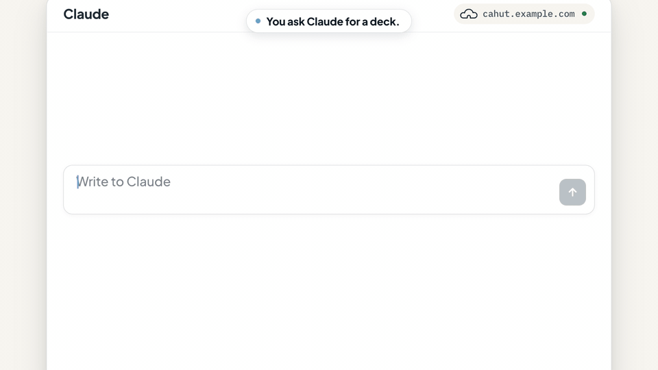
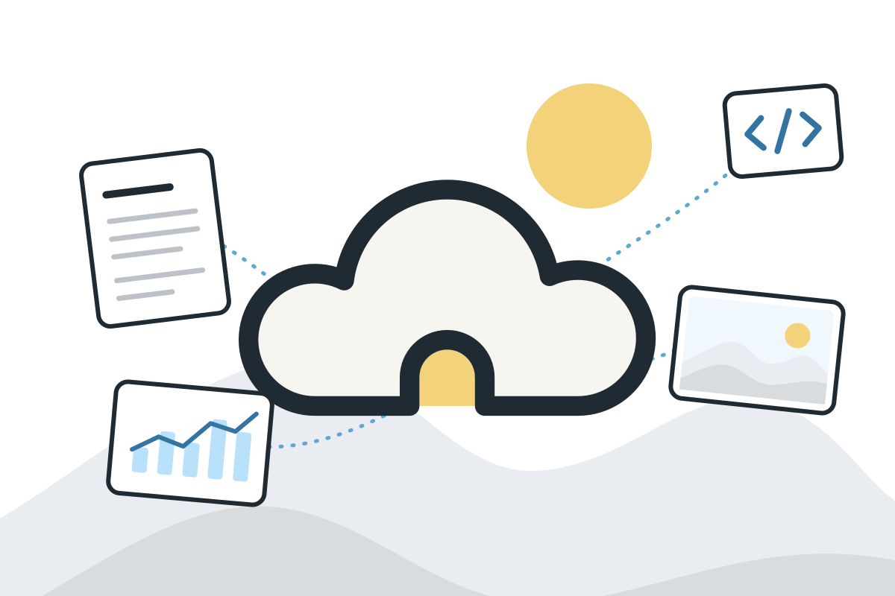
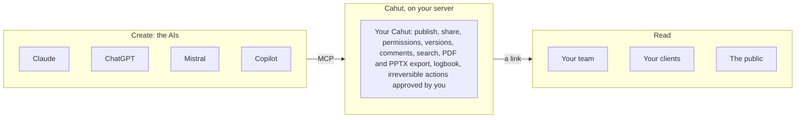
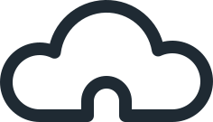

<div align="center">

<picture>
  <source media="(prefers-color-scheme: dark)" srcset="docs/charte-graphique/logos/cahut-logo-horizontal-inverse.svg">
  
</picture>

<h3>A home to publish and share what your AIs make.</h3>

Documents, slide decks, dashboards and small apps, as pages at your address<br>
on your own server, where your team works on them, whichever AI made them.

<p>
  <a href="https://github.com/cahutcloud/cahut/releases/latest"></a>
  <a href="https://github.com/cahutcloud/cahut/actions/workflows/ci.yml"></a>
  <a href="LICENSE"></a>
  <a href="go.mod"></a>
  <a href="https://www.bestpractices.dev/projects/15845"></a>
</p>

**[Website](https://cahut.cloud)** · **[Documentation](https://docs.cahut.cloud)** · **[Brand](https://cahut.cloud/brand)** · **[Contributing](CONTRIBUTING.md)** · **[Security](SECURITY.md)**

<br>



</div>

<br>

Cahut installs with one command on a Linux server. Claude, ChatGPT, Mistral or Copilot publish to it over MCP, and you share a link instead of sending a file. Your team reads it, comments on it and asks the AI for the next version, in Rooms where people and their AIs work on the same Windows. The AI does on its own what can be undone, a human approves the rest, and every action is logged.

> [!WARNING]
> Cahut is in early development. Its first version installs on a server, connects Claude and ChatGPT, publishes and shares documents, decks, dashboards and sites, and finds them by tag or by word, as [Installation](#installation) shows. Apps, comments, export, single sign-on and backups come before the public launch: the rest of this page describes the launch. There are no backups yet, so keep snapshots of your server.

## Why Cahut

Today, what your AIs make stays at the AI's place. A Claude link, a ChatGPT link, a Gamma deck: each lives on the service of the AI that made it. To publish it, share it or work on it with others, you turn it back into a file.

The file is going away. Word, PowerPoint and Excel were designed for humans who write, lay out and calculate by hand. When an AI makes the content, a page at its own address does better: it updates, takes comments, keeps its versions, and exports to PDF or PowerPoint for whoever still needs a file.

Publish, share, work together: today, all three are hard.

- **Scattered**: a Claude link here, a ChatGPT link there, a Gamma deck somewhere else. Each AI keeps what it makes on its own service, so nothing is published in one place.
- **Converted back**: to share it, the result is turned back into a PowerPoint or a Word file, then attached and forwarded.
- **Uncontrolled**: who has access, until when, which version is the right one, where the data lives. Nobody really knows.
- **Alone**: each person works with their own AI. The team has no common place where its work lives and where it works on it together.
- **Unguarded**: handing a server to an AI means giving it a root shell, or going through a platform built for humans that it can barely use.

<p align="center">
  
</p>

**Your AIs make it and publish it. You share it and work on it together.** Everything they produce lives in one place, as pages at your address, on your server, whatever the AI.

Cahut does not create content, it hosts it. It does not compete with AIs or creation tools: it is the neutral, self-hosted home where their work lives, and where your team works on it.

| Layer | Who handles it | What it brings |
| --- | --- | --- |
| Create | The AIs (Claude, ChatGPT, Mistral, Copilot...) | The content: documents, decks, dashboards, apps |
| Publish, share, work together | Cahut, on your server | A page at your address, a link opened to the right people, Rooms where the team and its AIs work, versions, comments, search, export, logbook |

## How it works

The AIs stay outside. They connect to Cahut over MCP, drop their work through bounded operations, then disconnect. No AI model runs on the server.



1. **Connect.** Add Cahut to your AI (MCP connector and skill) and authorize it once with OAuth, with the scope you choose.
2. **Create.** Ask your AI for a document, a deck, a dashboard or an app, in the style you want. The skill for Claude gives it the formats.
3. **Publish.** The AI publishes a Window to a Room, declares what it does, and gets its address back, such as `cahut.example.com/marketing/q3-review`. The previous version is kept.
4. **Share.** You, or the AI within the limits you set, choose who opens each Window: its Room only, everyone in your Cahut, anyone with its Key, or the public. Anything irreversible waits for approval in the console.
5. **Live.** Readers open the page in a browser and comment on it. The AI updates it on request. Everything goes to the logbook.

## Features

The full scope ships at launch, with no reduced trial version.

| Area | At launch |
| --- | --- |
| Installation | One command on a fresh VPS or dedicated server (AlmaLinux or Ubuntu), guided first start, linking of the admin and their first AI |
| AI access | Native MCP server (HTTP, OAuth), one skill per AI client packaged as a plugin where the client allows it, Claude first then ChatGPT, Mistral, Copilot and others, SSH access limited to the same operations for terminal AIs |
| Pages | Documents, decks, dashboards and static sites, each at its own address in its Room |
| Apps | Predefined runtimes (Node, Python...) and an advanced Dockerfile mode, variables and secrets, PostgreSQL or SQLite databases, runtime logs, resource limits |
| Sharing | By link, Window by Window: its Room only, internal (everyone in the Cahut), a Key (a password) or public, with an optional end date |
| Invitations | A Window sent by e-mail, to people of the Cahut or outside it, with a personal link in place of its Key |
| Versions | Two versions kept per publication, roll back in one gesture |
| Comments | Reader feedback directly on the pages |
| Search | Find any page, deck or dashboard of your Rooms by a word of it or a tag |
| Export | PDF and PowerPoint, for recipients still on Office |
| Users and Rooms | The people of each Cahut and its admins, a personal Room for each person, team Rooms with owners and members |
| Sign-in | Accounts of each Cahut, and single sign-on with OpenID Connect (Google, Microsoft Entra, Okta...) |
| Web console | See what is published, share, comment, approve irreversible actions, administer the server and its Cahuts, under `/console/` of each Cahut |
| Domains and TLS | Several Cahuts per server, each at its own domain or subdomain, no wildcard needed, automatic certificates |
| Limits | People, Rooms, Windows and disk for each Cahut, set by the administrators of the server, and Cahuts where each person works alone |
| Logbook | History of every action: who, which AI, on whose behalf, with what result |
| Backups | Optional, to external S3 or SFTP storage, restore from the console |
| Updates | Automatic, checked against the releases published on GitHub, with rollback |

What Cahut does **not** do:

- Create content: that is the AIs' job.
- Run an AI model on the server: the AIs stay outside and connect to it.
- Depend on one AI vendor, or lock work into a proprietary format.
- Give an AI free access to the server.
- Run across several machines: one server holds one or more Cahuts.

## Governance: knock first

The AI is the intended operator of Cahut, but never without guardrails.

1. **Bounded operations.** The AI acts through typed operations (publish a page, create a database, share a link), never through a free shell, over MCP as over SSH.
2. **Reversible or approved.** What can be undone, the AI does alone. What cannot waits for a human to approve it in the console, with a notification and an expiry.
3. **The AI declares what it publishes.** Each publication states what it contains and what it does (an app that collects data, calls out, opens a form).
4. **Per-agent permissions.** Each AI acts on behalf of a person, with the scope that person grants, revocable at any time.
5. **Everything is logged.** Which AI, on whose behalf, which action, which result: the logbook is readable in the console.
6. **Data stays home.** Everything lives on your server. Backups only go to the external storage you choose.
7. **Isolation.** Each Window runs in a sandbox: its scripts cannot read the other Windows, the console or the reader's session. Each app runs in an unprivileged container with its own resource limits. The Cahuts of one server share nothing but the machine.

| The AI does it alone (reversible) | A human approves (irreversible) |
| --- | --- |
| Publish or update a Window (the previous version is kept) | Permanently delete a Window, an app or a database |
| Restrict access, extend a lifetime | Make a Window public |
| Deploy an app within the set limits | Add a person to a Cahut |
| Roll back to the previous version | Change the permissions of a user or an AI |
| Run a backup | Erase backups or change their destination |

## Vocabulary

Cahut speaks the language of the house, in plain English.

| Word | What it means |
| --- | --- |
| Cahut | An instance on your server, at its own domain. One server can hold several |
| Room | A personal or team space, with its members, at `<domain>/<room>` |
| Window | A living page: document, deck, dashboard or app, at `<domain>/<room>/<window>` |
| Key | The password that opens a protected Window |
| Knock first | The governance rule: the AI knocks before any irreversible action |
| Logbook | The record of every action |

Each Window opens to its Room only, to everyone in the Cahut, to anyone with its Key, or to the public.

## Requirements

- One server, a VPS or a dedicated machine, for one or more Cahuts.
- Minimum 2 vCPU, 4 GB of RAM, 40 GB of disk.
- AlmaLinux or Ubuntu, from the provider's standard image.
- One domain or subdomain per Cahut, pointing to the server; until it has one, a Cahut can live at the server's public IPv4 address. Ports 80 and 443 open.

## Installation

On a fresh AlmaLinux or Ubuntu server, with ports 80 and 443 open and a domain that points to it, run:

```bash
curl -fsSL https://cahut.cloud/install.sh | sudo sh -s -- --domain cahut.example.com
```

The script checks the signature of the release and installs Cahut as a systemd service. It opens the firewall, sets up the daily updates and runs `cahut doctor`. It ends with a single-use link: open it to finish in the browser, where you choose your account and connect your first AI. Without `--domain`, Cahut takes the server's public IPv4 address, with a certificate for that address. You can move it to a domain later, from the console.

Then give your AI the address of the MCP server, `https://cahut.example.com/mcp`. It sends you to the console to sign in and choose what it may do:

| AI client | Where |
| --- | --- |
| claude.ai, Claude Desktop | Settings, Connectors, add a custom connector, on every plan |
| Claude Code | `/plugin marketplace add cahutcloud/cahut`, then `/plugin install cahut@cahut`, which also brings the skill for Claude |
| Mistral Vibe, formerly Le Chat | Connectors, add a custom MCP connector, on every plan |
| ChatGPT | On the web, Plugins, Add custom MCP server, with OAuth, on the Business, Enterprise and Edu plans only: not on Free, Plus or Pro |
| Others | Any MCP client over HTTP, with OAuth or a personal token |

Ask it for a deck: it publishes a Window and gives you its address. You choose who opens it in the console.

Cahut updates itself every day from the signed releases, patch releases by default. It snapshots the databases first, and goes back on its own if the new version does not start. `sudo /usr/local/bin/cahut doctor` says what is wrong with the server, and `sudo /usr/local/bin/cahut update` updates at once. The [documentation](https://docs.cahut.cloud/install/server/) covers the rest: the options of the installer, a Cahut without a domain, several Cahuts on one server, and updates.

## Development

Cahut is written in **Go**: a new, clean codebase built for Cahut, which one person must be able to carry end to end. Go gives a single static binary that is simple to install and update on a standard Linux, and a standard library that covers HTTP, TLS and cryptography.

### Technical choices

| Topic | Choice | Status |
| --- | --- | --- |
| Nature | A platform on a standard Linux, not an operating system | Decided |
| Hosting | One server holds one or more Cahuts, each with its own domain, people and data | Decided |
| Language | Go | Decided |
| AI interface | MCP over HTTP with OAuth, forced-command SSH for the same operations | Decided |
| Web console | A Preact app embedded in the binary, served under `/console/` of each Cahut, using the same API as the AIs: no capability is reserved for it | Decided |
| Web and TLS | Built into the binary, automatic certificates with CertMagic, Windows at paths of their Cahut's domain, each in a CSP sandbox | Decided |
| Database | SQLite in pure Go, so the binary stays static, one database per Cahut | Decided |
| Authorization | Cahut's own minimal OAuth 2.1 server, built for MCP clients | Decided |
| Updates | Automatic, latest version checked on GitHub, rollback possible | Decided |
| Backups | Optional, to external S3 or SFTP | Decided |
| Website and docs | Astro sites in this repository, built on the brand guidelines, served from the project's own server | Decided |
| Apps | Predefined runtimes and Dockerfile mode, on an unprivileged container engine (Podman or Docker) | Open |
| License | AGPL-3.0 for the repository; the name and the logo stay apart | Decided |

The reasons behind each choice are in the [architecture decision records](docs/adr/README.md).

### Repository layout

```
cmd/cahut/   Entry point of the cahut binary
internal/    The code of Cahut, private to this module
install.sh   Installs Cahut on a server as a systemd service
docs/        Project documents: architecture decision records in English; the brief, the V0 plan and the brand guidelines in French for now
sites/       The website and the documentation, Astro sites built on the brand guidelines
```

### Building

Building Cahut needs Go 1.27 or later, make, and Node.js at the version of `.nvmrc` for the web console, which the binary embeds. `make build` builds `bin/cahut`, and `make check` runs the linters, govulncheck and the tests, as CI does, without Node.js. Run `make` for the full list of tasks. The sites need Node.js too: see [sites/README.md](sites/README.md).

Releases are static binaries for linux/amd64 and linux/arm64, built by GoReleaser when a version tag is pushed.

## Roadmap

1. Protect the name: GitHub organization, package names, trademark search.
2. Write the target architecture: compare the options and settle them, with their reasons.
3. Build the first vertical slice in Go: install on a server, publish a page over MCP, serve it over HTTPS.
4. Proof of concept: Cahut installed on a fresh VPS, an AI publishing a deck over MCP, the console.
5. Roadmap to the public launch.

Success criteria for the launch:

| Criterion | Threshold |
| --- | --- |
| Install on a fresh VPS | Under 10 minutes, one command |
| First publication by an AI | Under 5 minutes, without touching the server |
| Sharing by a non-technical person | A deck shared by link in a few minutes |
| Supported AIs | The same Cahut works with at least two different AI clients |
| Governance | Every AI action is in the logbook, and is either reversible or was approved |

## Documentation

- [Project brief](docs/brief-projet.md) (French): vision, positioning, scope, governance, technical choices and open questions.
- [V0 plan](docs/plan-v0.md) (French): scope, batches and milestones of the first version.
- [Governance and project life](docs/gouvernance.md) (French): how the project is run and how it lives: roles, contributions, support, channels, releases, security, name, license and money, with the decisions still open.
- [Architecture decision records](docs/adr/README.md): each technical choice, its reasons and the options set aside.
- [Brand guidelines](docs/charte-graphique/README.md) (French): logo, colors, typography, icons, illustrations, photography, interface kit and templates, with all source files. A visual version opens from [docs/charte-graphique/index.html](docs/charte-graphique/index.html).

## Contributing and community

Cahut is maintained by one person, in the open. [GOVERNANCE.md](GOVERNANCE.md) says how the project is run, [CONTRIBUTING.md](CONTRIBUTING.md) what helps and how a change gets in, [SUPPORT.md](SUPPORT.md) where to ask for help, and [SECURITY.md](SECURITY.md) how to report a vulnerability, privately. Everyone who takes part follows the [code of conduct](CODE_OF_CONDUCT.md).

## License

Cahut is free software under the GNU Affero General Public License, version 3 ([LICENSE](LICENSE)). You can run it, study it, change it and share it. If you change it and let others use your version over a network, you give them your changes under the same license. Installing or distributing Cahut as it is asks nothing more than keeping the license with it.

The name Cahut and its logo identify this project and are not covered by this license. Say that something runs on Cahut or works with Cahut; do not use the name or the logo for a product, a service or a domain of your own, and give a fork its own name. [TRADEMARK.md](TRADEMARK.md) says this in full.

[ADR 15](docs/adr/0015-license.md) records the decision and the options set aside.

## Author

Cahut is a personal project by Olivier Durand, independent of any company and of any AI vendor.

<br>

<div align="center">

<picture>
  <source media="(prefers-color-scheme: dark)" srcset="docs/charte-graphique/logos/cahut-symbole-inverse.svg">
  
</picture>

<sub><a href="https://cahut.cloud">cahut.cloud</a> · <a href="https://docs.cahut.cloud">docs.cahut.cloud</a></sub>

</div>
