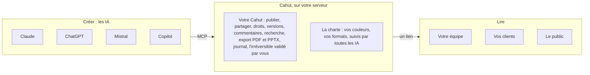

# Cahut · Brief projet

20 octobre 2026, mis à jour le 21 octobre 2026 · Olivier Durand

## En bref

Cahut est la maison de tout ce que vos IA fabriquent : documents, présentations, tableaux de bord et petites applis y vivent en ligne, comme des pages vivantes, à vos couleurs et sur votre propre serveur, quelle que soit l'IA qui les a créés.

On l'installe d'une commande sur un VPS. Claude, ChatGPT, Mistral ou Copilot y publient par MCP, et l'on partage un lien au lieu d'envoyer un fichier. L'IA fait seule ce qui s'annule, un humain valide le reste, et tout est tracé.

- **Nom** : Cahut
- **Adresses** : cahut.cloud (site), getcahut.com (redirection), déjà réservés
- **Nature** : Plateforme open source installée sur un Linux standard ; un serveur porte un ou plusieurs Cahuts, chacun à son domaine
- **Porteur** : Olivier Durand, à titre personnel, indépendant de toute société et de tout fournisseur d'IA
- **Lancement** : En anglais, périmètre complet dès le départ, dépôt privé jusque-là

## Vision et positionnement

Le fichier disparaît. Word, PowerPoint et Excel ont été conçus pour des humains qui écrivent, mettent en page et calculent à la main ; quand l'IA fabrique le contenu, elle produit naturellement des pages vivantes, chacune avec son adresse. On n'envoie plus une pièce jointe, on partage un lien : la page se met à jour, se commente, garde ses versions et s'exporte en PDF ou en PowerPoint pour qui en a encore besoin.

Ce n'est pas une hypothèse : mises devant une plateforme de ce type, des personnes non techniques l'adoptent en quelques semaines et publient elles-mêmes présentations, sites et applis faits par l'IA.

**Le problème.** Ce que l'IA fabrique n'a pas de maison.

- **Éparpillé** : un lien Claude ici, un lien ChatGPT là, une présentation Gamma ailleurs ; chaque IA garde chez elle ce qu'elle fabrique.
- **Retransformé** : faute de mieux, on reconvertit le résultat en PowerPoint ou en Word pour pouvoir le partager et le ranger.
- **Sans contrôle** : qui y a accès, jusqu'à quand, quelle version fait foi, où sont les données ? Personne ne le sait vraiment.
- **Sans cohérence** : chaque IA produit son propre style, et la charte de l'organisation se perd.
- **Sans garde-fou** : confier un serveur à une IA, c'est lui ouvrir un shell root ou passer par une plateforme pensée pour des humains, à laquelle elle accède mal.

**La promesse.** Vos IA fabriquent, Cahut fait vivre. Tout ce qu'elles produisent est publié, partagé, rangé et protégé au même endroit, à vos couleurs, chez vous, quelle que soit l'IA.

**Le positionnement.** Cahut ne crée pas le contenu, il l'accueille. Il ne concurrence pas les IA ni les outils de création : il est la maison neutre et souveraine où leur travail vit, avec trois couches bien séparées.

| Couche | Qui s'en charge | Ce qu'elle apporte |
| --- | --- | --- |
| Créer | Les IA (Claude, ChatGPT, Mistral, Copilot…) | Le contenu : documents, présentations, tableaux de bord, applis |
| Garder et partager | Cahut, sur votre serveur | Publication, liens, droits, versions, commentaires, recherche, export, journal |
| À quoi ça ressemble | La charte, portée par Cahut | Vos couleurs et vos formats, fournis à toutes les IA sous forme de modèles et de skills |

## Pour qui

Le grand public visé, ce sont tous ceux qui travaillent avec des documents et des présentations : l'expérience doit se passer de toute technique, mais celui qui installe et paie reste l'équipe, la PME ou le particulier équipé d'un VPS. Les très grandes organisations viendront plus tard.

| Qui | Rôle | Ce qu'il y gagne |
| --- | --- | --- |
| Consultants, commerciaux, chefs de projet | Premiers utilisateurs : ils fabriquent aujourd'hui des PowerPoint et des Word pour leurs clients | Un livrable à leurs couleurs en quelques minutes, un lien à envoyer, des retours en commentaires |
| Équipes et services (marketing, RH, direction) | Utilisateurs, membres de Rooms d'équipe | Un espace commun, des droits clairs, tout au même endroit |
| Dirigeant ou IT d'une PME | Administrateur et acheteur | La maîtrise : données chez soi, accès, durée de vie, journal, indépendance vis-à-vis des fournisseurs d'IA |
| Particuliers un peu geek | Administrateurs de leur propre Cahut, communauté open source | Un serveur à soi pour publier ce que fait leur IA |
| Visiteurs | Lecteurs : clients, partenaires, public | Une page qui s'ouvre dans un navigateur, sans compte, selon l'accès choisi |

**Modèle d'utilisateurs.** Un serveur porte un ou plusieurs Cahuts, chacun à son domaine (`cahut.exemple.fr`). L'administrateur du serveur déclare les Cahuts ; chaque Cahut a ses propres administrateurs, ses personnes et ses Rooms, sans rien partager avec les autres. Chaque personne a sa Room personnelle, unique, et peut être membre ou propriétaire de Rooms d'équipe. Les agents IA agissent toujours au nom d'une personne, avec les droits qu'elle leur donne.

## Ce que fait Cahut

Tout le périmètre ci-dessous est livré dès le lancement : pas de version réduite.

| Domaine | Au lancement |
| --- | --- |
| Installation | Une commande sur un VPS ou un serveur dédié vierge (AlmaLinux ou Ubuntu), premier démarrage guidé, rattachement de l'administrateur et de sa première IA |
| Accès des IA | Serveur MCP natif (HTTP, OAuth) ; une skill par client IA, empaquetée en plugin quand le client le permet ; Claude d'abord, puis ChatGPT, Mistral, Copilot et les autres ; accès SSH limité aux mêmes opérations pour les IA de terminal |
| Pages | Documents, présentations, tableaux de bord et sites statiques, chacun à son adresse dans sa Room |
| Applis | Runtimes prédéfinis (Node, Python…) et mode avancé par Dockerfile ; variables et secrets ; bases PostgreSQL ou SQLite ; journaux d'exécution ; limites de ressources |
| Partage | Par lien, Window par Window : sa Room seulement, interne (tout le Cahut), Key (un mot de passe) ou public ; date de fin réglable |
| Versions | Deux versions gardées par publication, retour à la précédente en un geste |
| Commentaires | Retours des lecteurs directement sur les pages |
| Recherche | Retrouver une page, une présentation ou un tableau de bord dans tout ce qui est publié |
| Export | PDF et PowerPoint, pour les destinataires restés sous Office |
| Charte (*house style*) | Couleurs, polices, logos et modèles de l'organisation, fournis à toutes les IA pour que tout sorte à ses couleurs |
| Utilisateurs et Rooms | Personnes et administrateurs de chaque Cahut, une Room personnelle par personne, Rooms d'équipe avec propriétaires et membres |
| Connexion | Comptes propres à chaque Cahut, authentification unique (SSO) par OpenID Connect : Google, Microsoft Entra, Okta… |
| Console web | Voir ce qui est publié, partager, commenter, valider l'irréversible, administrer le serveur et ses Cahuts, sur son propre port HTTPS |
| Domaines et TLS | Plusieurs Cahuts par serveur, un domaine ou sous-domaine chacun, sans wildcard, certificats automatiques |
| Journal | Historique de chaque action : qui, quelle IA, au nom de qui, quel résultat |
| Sauvegardes | Vers un stockage S3 ou SFTP externe, facultatives, restauration depuis la console |
| Mises à jour | Automatiques, avec vérification des versions publiées sur GitHub et retour arrière |

**Ce que Cahut ne fait pas.**

- Créer le contenu : c'est le travail des IA.
- Remplacer un éditeur de texte ou de diapositives (question ouverte, voir plus bas).
- Héberger une IA ou un modèle sur le serveur : les IA restent à l'extérieur et s'y connectent.
- Dépendre d'un fournisseur d'IA ou enfermer le travail dans un format propriétaire.
- Donner à l'IA un accès libre au serveur.
- Fonctionner sur plusieurs machines : un serveur porte un ou plusieurs Cahuts.
- Être proposé en service hébergé au lancement (piste pour plus tard).

## Gouvernance et sécurité

L'IA est l'opératrice prévue de Cahut, mais jamais sans garde-fou : elle fait seule ce qui s'annule, un humain valide l'irréversible, et tout est tracé.

1. **Opérations bornées.** L'IA agit par des opérations typées (publier une page, créer une base, partager un lien), jamais par un shell libre, en MCP comme en SSH.
2. **Réversible ou confirmé (*knock first*).** Ce qui s'annule, l'IA le fait seule ; ce qui est irréversible attend la validation d'un humain dans la console, avec une notification et un délai d'expiration.
3. **L'IA déclare ce qu'elle publie.** Chaque publication dit ce qu'elle contient et ce qu'elle fait (une appli qui collecte des données, appelle l'extérieur, ouvre un formulaire).
4. **Des droits par agent.** Chaque IA agit au nom d'une personne, avec la portée que cette personne lui donne, révocable à tout moment.
5. **Tout est tracé.** Quelle IA, au nom de qui, quelle action, quel résultat : le registre (*logbook*) se consulte dans la console.
6. **Les données restent à la maison.** Tout vit sur votre serveur ; les sauvegardes partent seulement vers le stockage externe choisi.
7. **Isolation.** Chaque Window tourne dans un bac à sable (*sandbox*) : ses scripts ne peuvent lire ni les autres Windows, ni la console, ni la session du lecteur. Chaque appli tourne dans un conteneur sans privilèges, avec ses limites de ressources. Les Cahuts d'un même serveur ne partagent que la machine.

**Exemples proposés, à valider.**

| L'IA fait seule (réversible) | Un humain valide (irréversible) |
| --- | --- |
| Publier ou mettre à jour une Window (la version précédente est gardée) | Supprimer définitivement une Window, une appli ou une base |
| Restreindre un accès, prolonger une durée de vie | Rendre une Window publique |
| Déployer une appli dans les limites prévues | Ajouter une personne à un Cahut |
| Revenir à la version précédente | Changer les droits d'un utilisateur ou d'une IA |
| Lancer une sauvegarde | Effacer des sauvegardes ou en changer la destination |

## Comment ça marche

Les IA restent à l'extérieur : elles se connectent à Cahut par MCP, y déposent leur travail par des opérations bornées, puis se déconnectent. Le serveur n'héberge aucun modèle d'IA.

Cahut reçoit le travail des IA par MCP, l'habille de la charte de l'organisation, le garde sur votre serveur et le partage par un simple lien, sans fichier à envoyer.

1. **Connexion.** L'utilisateur ajoute Cahut à son IA (connecteur MCP et skill) et l'autorise une fois (OAuth), avec la portée qu'il choisit.
2. **Création.** Il demande à son IA un document, une présentation, un tableau de bord ou une appli ; la skill lui fournit les formats et la charte de l'organisation.
3. **Publication.** L'IA publie une Window dans une Room, déclare ce qu'elle fait et reçoit son adresse, comme `cahut.exemple.fr/marketing/q3-review` ; la version précédente est gardée.
4. **Partage.** L'utilisateur, ou l'IA dans les limites autorisées, choisit qui ouvre chaque Window : sa Room seulement, tout le Cahut, qui a sa Key, ou le public. Ce qui est irréversible attend une validation dans la console.
5. **Vie de la page.** Les lecteurs l'ouvrent dans un navigateur, la commentent ; l'IA la met à jour à la demande ; tout est au registre.

## Choix techniques

Cahut est une plateforme qui s'installe sur un Linux standard, pas un système d'exploitation : pas de distribution à maintenir, et une seule personne doit pouvoir tout porter.

| Sujet | Choix | Statut |
| --- | --- | --- |
| Nature | Plateforme sur un Linux standard, pas un OS | Décidé |
| Serveur | Un serveur, VPS ou dédié, porte un ou plusieurs Cahuts, chacun avec son domaine, ses personnes et ses données | Décidé |
| Machine minimale | 2 vCPU, 4 Go de RAM, 40 Go de disque | Décidé |
| Systèmes pris en charge | AlmaLinux et Ubuntu au lancement | Décidé |
| Installation | Une commande, depuis l'image standard du fournisseur, en moins de 10 minutes | Décidé |
| Base de code | Nouvelle et propre, écrite pour Cahut | Décidé |
| Langage | Go ou Rust, départagés par deux prototypes de la même tranche : installer, publier une page par MCP, la servir en HTTPS | À trancher |
| Interface IA | MCP en HTTP avec OAuth ; SSH à commande forcée pour les mêmes opérations | Décidé |
| Applis | Runtimes prédéfinis et mode Dockerfile ; moteur de conteneurs sans privilèges (Podman ou Docker) à choisir | À trancher |
| Web et TLS | Intégré au binaire, certificats automatiques ; les Windows sous les chemins du domaine de leur Cahut, chacune dans un bac à sable CSP | Décidé |
| Console web | Sur son propre port HTTPS, utilise la même API que les IA : aucune capacité ne lui est réservée | Décidé |
| Mises à jour | Automatiques, dernière version vérifiée sur GitHub, retour arrière possible | Décidé |
| Sauvegardes | Vers S3 ou SFTP externe, facultatives | Décidé |
| Licence | Permissive (Apache-2.0) ou copyleft réseau (AGPL-3.0, pour qu'un hébergeur ne puisse pas en faire un service fermé) | À trancher |

## Vocabulaire produit

Le produit parle le langage de la maison, en anglais simple : chaque notion technique a un mot que tout le monde comprend.

| Mot | Ce qu'il désigne |
| --- | --- |
| Cahut | Une instance sur votre serveur, à son propre domaine ; un serveur peut en porter plusieurs |
| Room | Un espace personnel ou d'équipe, avec ses membres, à l'adresse `<domaine>/<room>` |
| Window | Une page vivante : document, présentation, tableau de bord ou appli, à l'adresse `<domaine>/<room>/<window>` |
| Key | Le mot de passe qui ouvre une Window protégée |
| House style | La charte de l'organisation, appliquée par toutes les IA |
| Knock first | La règle de gouvernance : l'IA frappe avant toute action irréversible |
| Logbook | Le registre de toutes les actions |

Chaque Window s'ouvre à sa Room seulement, à tout le Cahut, à qui a sa Key, ou au public.

## Face aux autres

La création est occupée par des géants ; personne ne propose une maison neutre et souveraine pour le travail fait par toutes les IA.

| Acteur | Ce qu'il fait | Où Cahut se distingue |
| --- | --- | --- |
| [Microsoft 365 Copilot](https://pasqualepillitteri.it/en/news/1401/microsoft-copilot-agent-mode-word-excel-powerpoint-april-2026) | Depuis avril 2026, l'IA agit directement dans Word, Excel et PowerPoint ; le fichier reste au centre | Pas de fichier, toutes les IA et pas seulement Copilot, hors de l'écosystème Microsoft |
| [Gamma](https://sacra.com/c/gamma/) | Présentations, documents et sites générés par IA ; environ 70 millions d'utilisateurs, valorisé 2,1 milliards de dollars en novembre 2025 | Gamma crée et héberge chez lui ; Cahut accueille le travail de toutes les IA, chez vous |
| [ChatGPT](https://help.openai.com/en/articles/20001339), Claude | Créent et publient des pages et des documents partageables, chacun dans son propre service | Neutre : un seul endroit pour ce que produisent toutes les IA, avec votre charte et vos règles |
| [Nextcloud](https://itdaily.com/blogs/software/nextcloud-review-european-and-open-source-alternative-to-microsoft-365/) | Alternative européenne et open source à Microsoft 365 : fichiers, bureautique, collaboration, sur son serveur ou chez un hébergeur | Le modèle à suivre (open source, souverain, hébergeurs partenaires), mais pensé pour les fichiers ; Cahut l'est pour les pages vivantes produites par l'IA |
| PaaS auto-hébergés (Coolify, Dokploy, CapRover, Dokku) | Déploient des applis sur son serveur, pilotés par des développeurs depuis une interface web | Conçu pour que l'IA opère et que des non-techniciens publient, avec opérations bornées, validation de l'irréversible et documents vivants |

## Open source, lancement et modèle

Cahut est un projet personnel, ouvert dès le lancement : il doit installer une réputation de vision et de sérieux technique, dans l'esprit d'OpenClaw.

- **Pourquoi l'open source.** Notoriété, crédibilité technique, image de visionnaire ; et la souveraineté n'est crédible que si le code se lit.
- **Avant le lancement.** Dépôt GitHub privé, neuf, sans historique ni trace d'autres projets ; relecture complète avant ouverture.
- **Langue.** Anglais d'abord : site, documentation, interface et skills.
- **Périmètre.** Lancement avec tout le périmètre, pas de version d'essai réduite.
- **Adoption.** Tutoriels d'installation, puis partenariats avec des hébergeurs (OVH, Hostinger) pour une installation en un clic.
- **Modèle économique.** Remis à plus tard. Pistes : une offre hébergée en Europe, comme Nextcloud avec ses partenaires ; du support et des services pour les PME.

**Critères de réussite du produit.**

| Critère | Seuil |
| --- | --- |
| Installation sur un VPS vierge | Moins de 10 minutes, une commande |
| Première publication par une IA | Moins de 5 minutes, sans toucher au serveur |
| Partage par une personne non technique | Une présentation partagée par lien en quelques minutes |
| IA prises en charge | Le même Cahut fonctionne avec au moins deux clients IA différents |
| Gouvernance | Toute action d'une IA figure au registre, et s'annule ou a été validée |

## Prochaines étapes et questions ouvertes

La suite : protéger le nom, puis trancher l'architecture par des prototypes.

1. Valider ce brief.
2. Protéger le nom : réserver l'organisation GitHub et les noms npm, crates.io et PyPI ; faire une recherche d'antériorité de marque (INPI, EUIPO).
3. Écrire l'architecture cible : comparer les options et trancher, avec leurs raisons.
4. Construire deux prototypes de la même tranche, en Go et en Rust, puis choisir le langage.
5. Preuve de concept : Cahut installé sur un VPS vierge, une IA qui publie une présentation par MCP, la console.
6. Feuille de route jusqu'au lancement public.

**Questions ouvertes.**

- [ ] Dans quel ordre construire le périmètre complet avant l'ouverture ?
- [ ] Qui est le premier utilisateur cible : le particulier « geek » sur son VPS, ou l'équipe d'une PME ?
- [ ] Faut-il un éditeur pour retoucher une page à la main, ou toute modification passe-t-elle par l'IA ?
- [ ] Auto-hébergement seul au lancement, ou dès le départ une offre hébergée en Europe avec un hébergeur partenaire ?
- [ ] Les tâches planifiées font-elles partie du lancement ?
- [ ] Quelle liste exacte d'actions irréversibles soumettre à validation ?
- [ ] Licence : Apache-2.0 ou AGPL-3.0 ?
- [ ] Compte GitHub : personnel ou organisation dédiée ?
- [ ] Quel lien avec la vision EKLOS ?

## Sources

- [Gamma, chiffres et valorisation (Sacra)](https://sacra.com/c/gamma/)
- [Copilot Agent Mode dans Word, Excel et PowerPoint, avril 2026](https://pasqualepillitteri.it/en/news/1401/microsoft-copilot-agent-mode-word-excel-powerpoint-april-2026)
- [ChatGPT Sites (aide OpenAI)](https://help.openai.com/en/articles/20001339)
- [Nextcloud, alternative européenne et open source à Microsoft 365 (ITdaily)](https://itdaily.com/blogs/software/nextcloud-review-european-and-open-source-alternative-to-microsoft-365/)
