# Cahut · Charte graphique

Version 1.10 · 30 octobre 2026 · Olivier Durand


Cette charte fixe l'identité visuelle de Cahut : logo, couleurs, typographie, pictogrammes, illustrations, photographie, interface et applications. Elle part de la [planche retenue](planche-reference.png) et la rend utilisable : fichiers vectoriels, exports, jetons de design et règles d'usage.

- **Version visuelle** : [`index.html`](index.html), à ouvrir dans un navigateur, et sa version imprimable [`charte-graphique-cahut.pdf`](charte-graphique-cahut.pdf).
- **Fichiers** : tout est dans ce dossier, rangé par usage (voir [Fichiers](#13-fichiers)).
- **Langue** : la charte est rédigée en français ; les textes du produit et des visuels sont en anglais, langue du lancement.

## Sommaire

1. [La marque](#1-la-marque)
2. [Le logo](#2-le-logo)
3. [Couleurs](#3-couleurs)
4. [Typographie](#4-typographie)
5. [Pictogrammes et icônes](#5-pictogrammes-et-icônes)
6. [Illustrations et motif](#6-illustrations-et-motif)
7. [Photographie](#7-photographie)
8. [Mise en page](#8-mise-en-page)
9. [Interface](#9-interface)
10. [Applications](#10-applications)
11. [Voix et ton](#11-voix-et-ton)
12. [Les Windows](#12-les-windows)
13. [Fichiers](#13-fichiers)

## 1. La marque

**Le nom.** Cahut vient de « cahute », la petite cabane qu'on se construit soi-même. C'est un abri simple et à soi, posé dans le nuage : *cloud* et *hut* à la fois.

**La promesse.** Vos IA fabriquent, Cahut fait vivre. Tout ce qu'elles produisent est publié, partagé, rangé et protégé au même endroit, chez vous, quelle que soit l'IA.

**La signature.** *Your home to publish and share what your AIs make.* En français : *Votre maison pour publier et partager ce que fabriquent vos IA.* Elle accompagne le logo sur le site, les visuels de partage et les présentations.

**Les valeurs.**

| Valeur | Ce qu'elle veut dire | Ce qu'on voit |
| --- | --- | --- |
| Chez soi | Les données restent sur votre serveur | Le nuage est une maison, avec sa porte |
| Neutre | Toutes les IA, aucun fournisseur favori | Aucune couleur ni forme empruntée à une IA |
| Simple | Une commande pour installer, un lien pour partager | Peu d'éléments, beaucoup d'air |
| Prudente | L'IA frappe avant toute action irréversible (*knock first*) | La porte, le jaune réservé à ce qui attend une décision |
| Accueillante | Claire, chaleureuse, sans jargon | Arrondis, papier chaud, touche de soleil |

**La personnalité.**

| Cahut est | Cahut n'est pas |
| --- | --- |
| calme | froide |
| précise | technique |
| chaleureuse | mignonne |
| sûre d'elle | autoritaire |
| ouverte | bavarde |

## 2. Le logo

### Le symbole

Un nuage dessiné d'un seul trait, dont la base s'ouvre sur une porte. Le nuage dit « votre cloud », la porte dit « chez vous » : on y entre, et on frappe avant. Trait régulier, jonctions arrondies, aucune pointe : un abri, pas une forteresse.

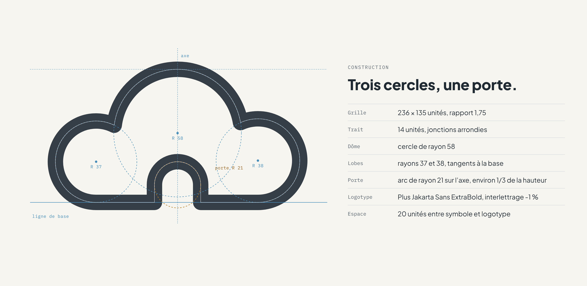

| Élément | Règle |
| --- | --- |
| Grille | 236 × 135 unités, rapport 1,75 |
| Trait | 14 unités (6 % de la largeur), jonctions arrondies |
| Dôme | Cercle de rayon 58 |
| Lobes | Rayons 37 et 38, tangents à la ligne de base |
| Porte | Arc de rayon 21 centré sur l'axe, environ un tiers de la hauteur |
| Logotype | « cahut » en minuscules, Plus Jakarta Sans ExtraBold, interlettrage -1 %, vectorisé |
| Assemblage | Logotype de même largeur que le symbole, 20 unités sous lui |

### Les versions

| Version | Usage | Fichiers |
| --- | --- | --- |
| Logo principal | Par défaut, sur fond clair | [`cahut-logo.svg`](logos/cahut-logo.svg) |
| Logo inversé | Sur Ink ou fond sombre | [`cahut-logo-inverse.svg`](logos/cahut-logo-inverse.svg) |
| Monochrome | Impression une couleur, gravure, tampon | [`cahut-logo-noir.svg`](logos/cahut-logo-noir.svg), [`cahut-logo-blanc.svg`](logos/cahut-logo-blanc.svg) |
| Logo horizontal | En-têtes, barres de navigation, pieds de page | [`cahut-logo-horizontal.svg`](logos/cahut-logo-horizontal.svg) et ses variantes |
| Symbole seul | Petits espaces, filigrane ; avec sa porte éclairée, l'avatar des réseaux (section 10) | [`cahut-symbole.svg`](logos/cahut-symbole.svg) et ses variantes |
| Symbole petites tailles | Sous 64 px, trait renforcé | [`cahut-symbole-petites-tailles.svg`](logos/cahut-symbole-petites-tailles.svg) |
| Logotype seul | Quand le symbole figure déjà à côté | [`cahut-logotype.svg`](logos/cahut-logotype.svg) |
| Icône d'application | Paper, symbole Ink, porte éclairée | [`cahut-icone-app.svg`](logos/cahut-icone-app.svg), variante [Ink](logos/cahut-icone-app-ink.svg) |
| Favicon | Dessiné sur la grille de 16 px | [`cahut-favicon.svg`](logos/cahut-favicon.svg), [`favicon/`](logos/favicon/) |

<p>
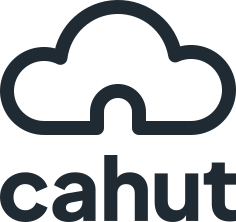&nbsp;&nbsp;&nbsp;
&nbsp;&nbsp;&nbsp;
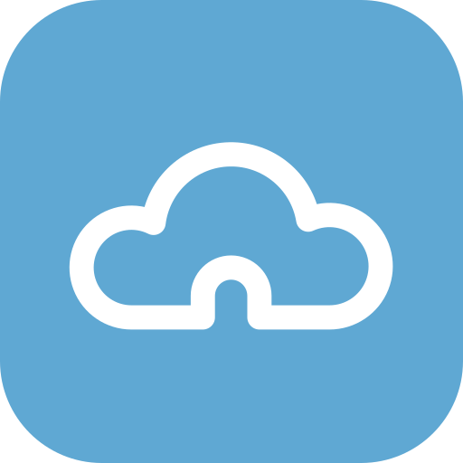
</p>

**La porte éclairée.** Sur l'icône d'application et l'avatar des réseaux, la porte s'allume en Soft Yellow : quelqu'un est là, comme dans les illustrations. Le jaune remplit l'arche sous le trait, jusqu'à la ligne de base. C'est le seul remplissage du symbole : le logo, le symbole seul et le logo horizontal gardent leur porte vide. Le fond est Paper, qui laisse au trait Ink 13,4:1 de contraste ; le blanc sur Sky n'en avait que 2,6:1.

Les exports PNG transparents sont dans [`logos/png/`](logos/png/), en plusieurs largeurs. Le logo horizontal utilise le symbole renforcé, aligné sur la ligne de base du logotype, à 1,2 fois la hauteur des ascendantes.

### Zone de protection et tailles minimales

Autour du logo, gardez un espace libre au moins égal à **p**, la largeur extérieure de la porte (environ un quart de la largeur du symbole).

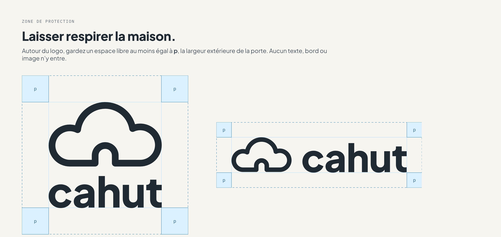

| Version | Écran | Impression |
| --- | --- | --- |
| Logo principal | 96 px de large | 25 mm |
| Logo horizontal | 100 px de large | 25 mm |
| Symbole | 24 px (version petites tailles) | 6 mm |
| Favicon | 16 px | non concerné |

### À ne pas faire

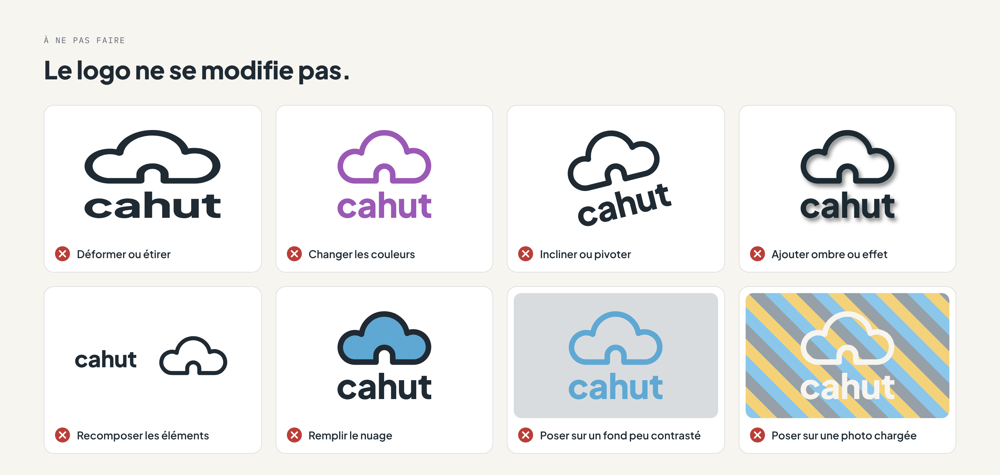

Ne pas déformer, recolorer, incliner, ombrer, recomposer ou remplir le logo, hors la porte éclairée de l'icône d'application et de l'avatar. Ne pas le poser sur un fond qui ne lui laisse pas 4,5:1 de contraste ni sur une photo chargée. Ne pas redessiner le logotype dans une autre police.

## 3. Couleurs

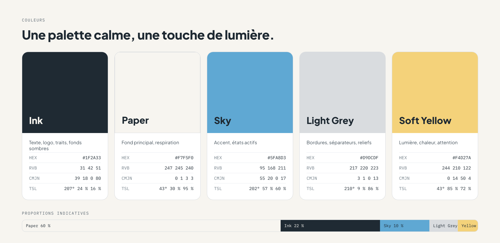

| Couleur | Rôle | HEX | RVB | CMJN | TSL |
| --- | --- | --- | --- | --- | --- |
| **Ink** | Texte, logo, traits, fonds sombres | `#1F2A33` | 31 42 51 | 39 18 0 80 | 207° 24 % 16 % |
| **Paper** | Fond principal | `#F7F5F0` | 247 245 240 | 0 1 3 3 | 43° 30 % 95 % |
| **Sky** | Accent, états actifs | `#5FA8D3` | 95 168 211 | 55 20 0 17 | 202° 57 % 60 % |
| **Light Grey** | Bordures, séparateurs, reliefs | `#D9DCDF` | 217 220 223 | 3 1 0 13 | 210° 9 % 86 % |
| **Soft Yellow** | Lumière, chaleur, attention | `#F4D27A` | 244 210 122 | 0 14 50 4 | 43° 85 % 72 % |

Les valeurs CMJN sont des conversions indicatives : faites une épreuve avec l'imprimeur (profil Fogra 39 ou ISO Coated v2) avant toute impression importante. Aucune référence Pantone n'est fixée à ce stade.

**Proportions indicatives** : Paper 60 %, Ink 22 %, Sky 10 %, Light Grey 5 %, Soft Yellow 3 %. Le jaune reste rare : il signale la lumière, la présence ou ce qui attend une décision (*knock first*).

### Nuances

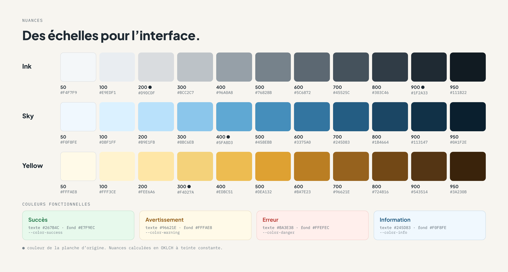

Pour l'interface, chaque couleur est déclinée en échelle de 50 à 950, calculée en OKLCH à teinte constante. Les couleurs de la planche sont des repères fixes : Light Grey = Ink 200, Ink = Ink 900, Sky = Sky 400, Soft Yellow = Yellow 300. Les couleurs fonctionnelles (succès, avertissement, erreur, information) sont accordées à la palette.

### Accessibilité

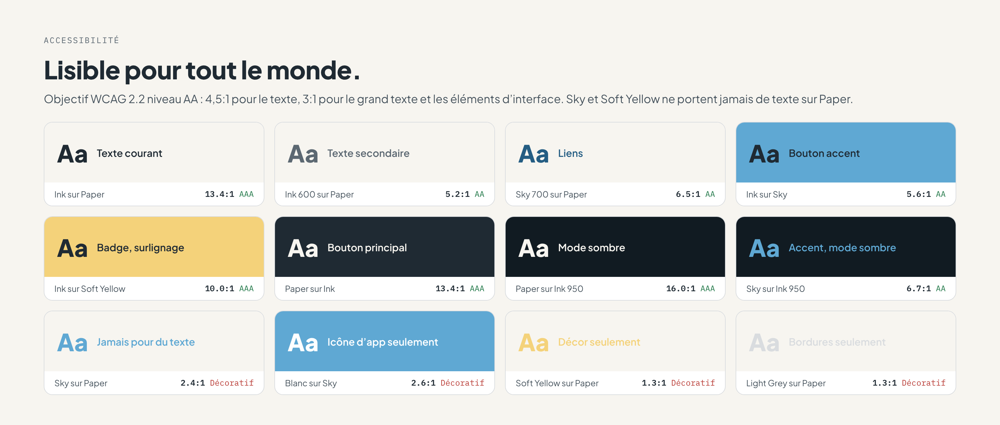

Objectif WCAG 2.2 niveau AA : 4,5:1 pour le texte courant, 3:1 pour le grand texte et les éléments d'interface.

| Combinaison | Contraste | Usage |
| --- | --- | --- |
| Ink sur Paper | 13,4:1 | Texte courant |
| Ink 600 sur Paper | 5,2:1 | Texte secondaire |
| Sky 700 sur Paper | 6,5:1 | Liens |
| Ink sur Sky | 5,6:1 | Texte sur bouton accent |
| Ink sur Soft Yellow | 10,0:1 | Badge, surlignage |
| Paper sur Ink 950 | 16,0:1 | Texte en mode sombre |
| Sky sur Ink 950 | 6,7:1 | Accent en mode sombre |
| Sky sur Paper | 2,4:1 | Jamais pour du texte, décor et grandes formes seulement |
| Blanc sur Sky | 2,6:1 | Jamais, ni pour du texte ni pour le logo |

Règle simple : sur Sky, on écrit en Ink, jamais en blanc. Sky et Soft Yellow ne portent jamais de texte sur Paper. Une information ne passe jamais par la couleur seule : on l'accompagne d'une icône ou d'un mot.

### Mode sombre

Fond Ink 950 (`#111B22`), surfaces Ink 900 et 800, texte Paper, texte secondaire Ink 300, accent Sky 400, liens Sky 300. Le logo passe en version inversée. Les jetons gèrent la bascule (voir [Interface](#9-interface)).

### Fichiers couleur

- [`tokens/cahut-tokens.css`](tokens/cahut-tokens.css) : variables CSS (valeurs brutes `--cahut-*` et rôles `--color-*`, thèmes clair et sombre).
- [`tokens/cahut-tokens.json`](tokens/cahut-tokens.json) : jetons au format Design Tokens Community Group (Figma Tokens, Style Dictionary).
- [`couleurs/cahut-palette.ase`](couleurs/cahut-palette.ase) : nuancier Adobe (Illustrator, InDesign, Photoshop).
- [`couleurs/cahut-palette.gpl`](couleurs/cahut-palette.gpl) : palette GIMP et Inkscape.

## 4. Typographie

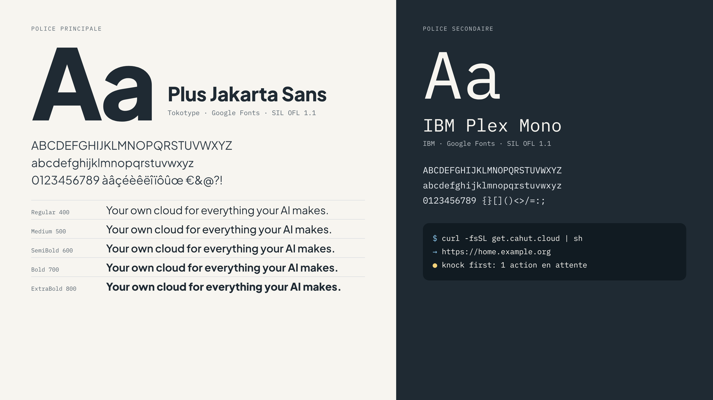

| Police | Rôle | Graisses | Licence |
| --- | --- | --- | --- |
| **Plus Jakarta Sans** | Police principale : titres, texte, interface | 400, 500, 600, 700, 800 | SIL OFL 1.1 |
| **IBM Plex Mono** | Police secondaire : adresses, code, données, étiquettes | 400, 500, 600 | SIL OFL 1.1 |

Les deux sont sur Google Fonts. Les fichiers sont fournis dans [`typographie/polices/`](typographie/polices/) : TTF pour la bureautique et le design, WOFF2 (sous-ensemble latin, français et anglais) pour le web, chargés par [`tokens/cahut-fonts.css`](tokens/cahut-fonts.css).

En secours : `ui-sans-serif, system-ui, "Segoe UI", sans-serif` et `ui-monospace, Menlo, Consolas, monospace`. Dans une présentation PowerPoint destinée à un poste sans les polices, utiliser Arial et Consolas.

### Hiérarchie

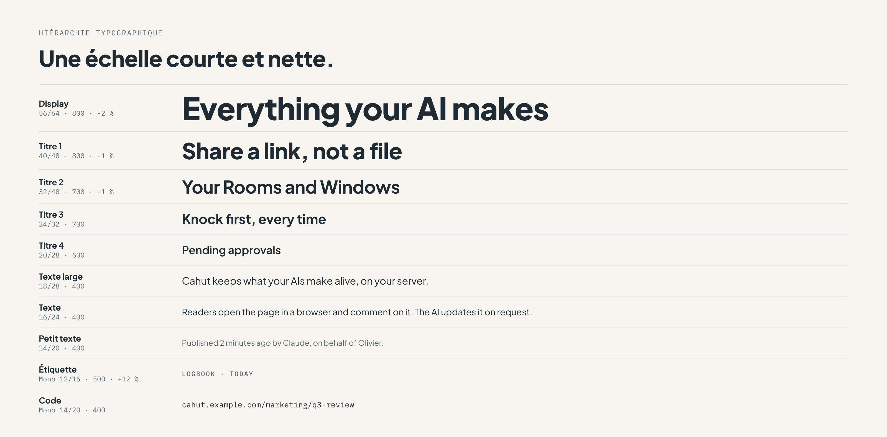

| Niveau | Taille / interligne | Graisse | Interlettrage |
| --- | --- | --- | --- |
| Display | 56 / 64 px | 800 | -2 % |
| Titre 1 | 40 / 48 px | 800 | -1 % |
| Titre 2 | 32 / 40 px | 700 | -1 % |
| Titre 3 | 24 / 32 px | 700 | 0 |
| Titre 4 | 20 / 28 px | 600 | 0 |
| Texte large | 18 / 28 px | 400 | 0 |
| Texte | 16 / 24 px | 400 | 0 |
| Petit texte | 14 / 20 px | 400 | 0 |
| Étiquette | Mono 12 / 16 px, capitales | 500 | +12 % |
| Code | Mono 14 / 20 px | 400 | 0 |

**Règles.** Titres en casse de phrase, sans point final sauf pour une phrase d'accroche. Texte aligné à gauche, jamais justifié. Lignes de 60 à 80 caractères. IBM Plex Mono pour tout ce qui se tape ou se copie : adresses (`cahut.cloud`), commandes, codes couleur, horodatages du *logbook*. Pas plus de deux graisses dans un même bloc.

## 5. Pictogrammes et icônes

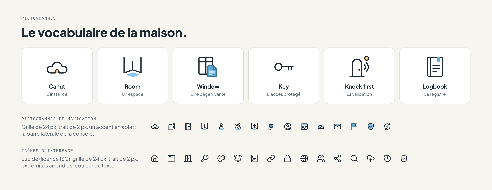

**Les pictogrammes** illustrent le vocabulaire de la maison : [Cahut](icones/cahut.svg), [Room](icones/room.svg), [Window](icones/window.svg), [Key](icones/key.svg), [Knock first](icones/knock-first.svg), [Logbook](icones/logbook.svg). La planche se refait depuis son gabarit, [`icones/gabarits/planche-pictogrammes.html`](icones/gabarits/planche-pictogrammes.html).

- Grille de 64 px, trait de 3 px, extrémités et angles arrondis.
- Trait en Ink (`currentColor`, modifiable en CSS), une seule couleur d'accent : Sky 300 pour les surfaces, Sky 400 pour les objets, Soft Yellow pour la lumière ou l'attente.
- Usage : site, documentation, écrans vides, accueil. Taille minimale 32 px.

**Les pictogrammes de navigation** ([`icones/navigation/`](icones/navigation/)) redessinent les pictogrammes pour la barre latérale de la console, où ils tiennent en 20 px à côté de leur étiquette.

- Grille de 24 px, trait de 2 px en Ink (`currentColor`), extrémités et angles arrondis.
- Le même accent en aplat que les pictogrammes : Sky 300 pour les surfaces, Sky 400 pour les objets, Soft Yellow pour la lumière ou l'attente. Le jaune reste à Cahut et à Knock first.
- Des détails réduits : deux lignes au carnet du Logbook, une onde de moins à Knock first. Les murs de la Room ne passent pas à cette taille ; les Rooms posent leurs personnes sur son sol bleu.
- Toujours en couleur et toujours avec une étiquette. La couleur d'un pictogramme de navigation ne compte pas dans l'accent unique d'un écran, qui vaut pour son contenu.

| Pictogramme | Fichier | Entrée de la console |
| --- | --- | --- |
| Cahut | [`cahut.svg`](icones/navigation/cahut.svg) | Overview |
| Knock first | [`knock-first.svg`](icones/navigation/knock-first.svg) | Knocks |
| Logbook | [`logbook.svg`](icones/navigation/logbook.svg) | Logbook, Logbook of the server |
| Room | [`room.svg`](icones/navigation/room.svg) | Une Room à soi dans une Cahut individuelle, Rooms pour un administrateur du serveur |
| Room personnelle | [`room-personal.svg`](icones/navigation/room-personal.svg) | La Room de chaque personne : une personne sur le sol de la Room |
| Room d'équipe | [`room-team.svg`](icones/navigation/room-team.svg) | Une Room d'équipe : deux personnes sur le sol de la Room |
| Nouvelle Room | [`room-new.svg`](icones/navigation/room-new.svg) | New Room, Every Room |
| IA et accès | [`ai-access.svg`](icones/navigation/ai-access.svg) | AIs and access : une prise, jamais un robot |
| Compte | [`account.svg`](icones/navigation/account.svg) | Account |
| Personnes | [`people.svg`](icones/navigation/people.svg) | People : une carte de membre |
| Type et limites | [`limits.svg`](icones/navigation/limits.svg) | Kind and limits |
| E-mail | [`email.svg`](icones/navigation/email.svg) | E-mail |
| Modération | [`moderation.svg`](icones/navigation/moderation.svg) | Moderation : un drapeau, celui qu'on lève pour signaler |
| Administrateurs du serveur | [`server-admins.svg`](icones/navigation/server-admins.svg) | Server administrators |
| Mises à jour | [`updates.svg`](icones/navigation/updates.svg) | Updates |

**Les icônes d'interface** viennent de [Lucide](https://lucide.dev) (licence ISC) : grille de 24 px, trait de 2 px, extrémités arrondies, couleur du texte. Tailles 16, 20 ou 24 px. Une action importante a toujours une étiquette texte à côté de son icône.

## 6. Illustrations et motif

| Illustration | Usage |
| --- | --- |
| [`maison-ouverte.svg`](illustrations/maison-ouverte.svg) | Héros du site, visuels de partage : les Windows des IA rejoignent la maison |
| [`paysage.svg`](illustrations/paysage.svg) | Emplacement d'image, fond de diapositive, aperçu de présentation |
| [`etat-vide.svg`](illustrations/etat-vide.svg) | Écran vide : « No Windows yet » |
| [`motif-nuages.svg`](illustrations/motif-nuages.svg) | Fond discret raccordable (variantes [Sky](illustrations/motif-nuages-sky.svg) et [blanche](illustrations/motif-nuages-blanc.svg)) |

<p>
&nbsp;&nbsp;
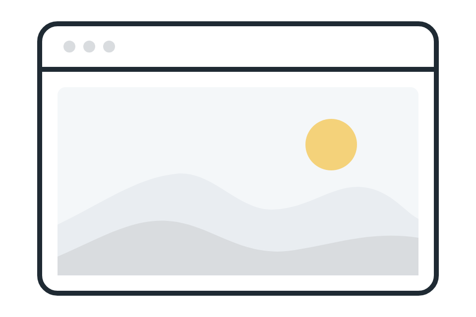
</p>

**Style.** Aplats sans dégradé ni ombre. Traits Ink arrondis, d'épaisseur régulière. Collines en Ink 100 et Ink 200, soleil en Soft Yellow, accents en Sky. Beaucoup d'air. La porte éclairée en jaune signifie « quelqu'un est là ».

**À éviter.** Robots, cerveaux, circuits lumineux, étincelles « magiques », personnages en 3D : Cahut ne fait pas l'IA, elle l'accueille.

## 7. Photographie

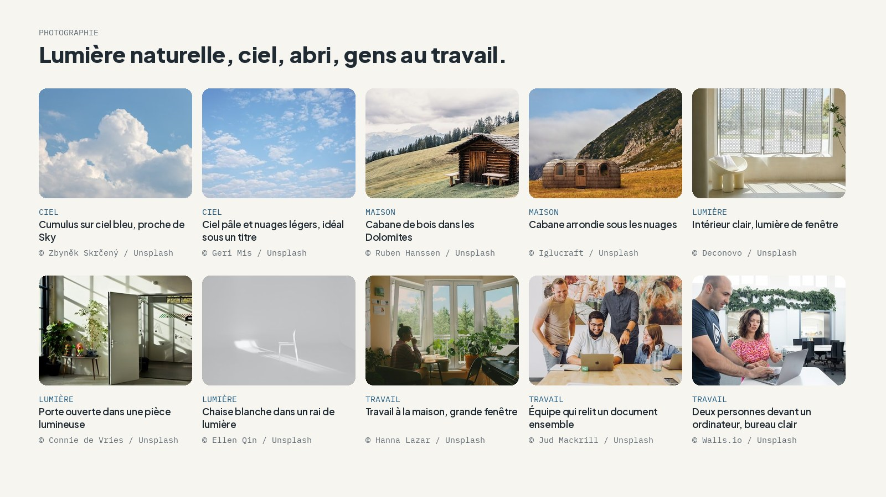

**Direction.** Lumière naturelle du jour, tons clairs et doux (blanc cassé, bois, bleu ciel), lieux réels et calmes, échelle humaine. Quatre familles :

- **Ciel** : nuages, ciel dégagé, proches de Sky.
- **Maison** : cabanes, abris, refuges dans le paysage.
- **Lumière** : fenêtres, portes ouvertes, intérieurs clairs.
- **Travail** : des gens qui travaillent sereinement, seuls ou à plusieurs, écrans présents mais secondaires.

**À éviter.** Ambiances sombres et néons, robots et visualisations abstraites de l'IA, poignées de main de banque d'images, filtres appuyés, scènes encombrées.

**Traitement.** Pas de filtre de couleur. Coins arrondis de 16 px dans l'interface. Texte sur photo seulement dans une zone calme, sur un bandeau Paper ou un voile Ink à 60 %, avec 4,5:1 de contraste.

**Sélection Unsplash.** Les aperçus (400 px) sont dans [`photos/apercus/`](photos/apercus/). Le domaine d'images d'Unsplash n'était pas accessible depuis l'environnement de travail : lancez [`photos/telecharger-photos.sh`](photos/telecharger-photos.sh) pour récupérer les fichiers en 2400 px. Licence [Unsplash](https://unsplash.com/license) : usage libre, crédit apprécié (« Photo : Nom / Unsplash »).

| Fichier | Thème | Photographe |
| --- | --- | --- |
| `ciel-cumulus` | Ciel | [Zbyněk Skrčený](https://unsplash.com/@skrcenyz) · [photo](https://unsplash.com/photos/MSrUdvVrKEE) |
| `ciel-voile` | Ciel | [Geri Mis](https://unsplash.com/@gerimis) · [photo](https://unsplash.com/photos/ZaCPb3xIqrg) |
| `cabane-alpage` | Maison | [Ruben Hanssen](https://unsplash.com/@rhfhanssen) · [photo](https://unsplash.com/photos/D3GYSD-eHUw) |
| `cabane-nuages` | Maison | [Iglucraft](https://unsplash.com/@iglucraft) · [photo](https://unsplash.com/photos/uTuAzjMjYww) |
| `interieur-lumiere` | Lumière | [Deconovo](https://unsplash.com/@deconovo) · [photo](https://unsplash.com/photos/lZfBkUqknEI) |
| `porte-ouverte` | Lumière | [Connie de Vries](https://unsplash.com/@conniedevries) · [photo](https://unsplash.com/photos/piU592i7ocY) |
| `chaise-lumiere` | Lumière | [Ellen Qin](https://unsplash.com/@ellenqin) · [photo](https://unsplash.com/photos/bOOQ3z2WjOs) |
| `bureau-maison` | Travail | [Hanna Lazar](https://unsplash.com/@potokvarte) · [photo](https://unsplash.com/photos/Nwj_ESx66Zk) |
| `equipe-relecture` | Travail | [Jud Mackrill](https://unsplash.com/@judmackrill) · [photo](https://unsplash.com/photos/Of_m3hMsoAA) |
| `duo-ecran` | Travail | [Walls.io](https://unsplash.com/@walls_io) · [photo](https://unsplash.com/photos/dYfN5RZY1B8) |

## 8. Mise en page

- **Grille** : 12 colonnes, gouttières de 24 px, marges de 32 px (16 px sur mobile). Largeur de lecture maximale 720 px.
- **Espacements** : multiples de 4 px (4, 8, 12, 16, 24, 32, 48, 64, 96).
- **Rayons** : 6 px pour les petits contrôles, 10 px pour les boutons et champs, 16 px pour les cartes, 24 px pour les grands panneaux.
- **Bordures** : 1 px en Light Grey (Ink 200). Ombres très légères, jamais de lueur colorée.
- **Fond** : Paper par défaut, cartes en blanc. Ink pour les moments forts (section, citation, pied de page).
- **Respiration** : laisser au moins un tiers de vide dans une composition. Un seul accent Sky par écran, un seul jaune.

## 9. Interface

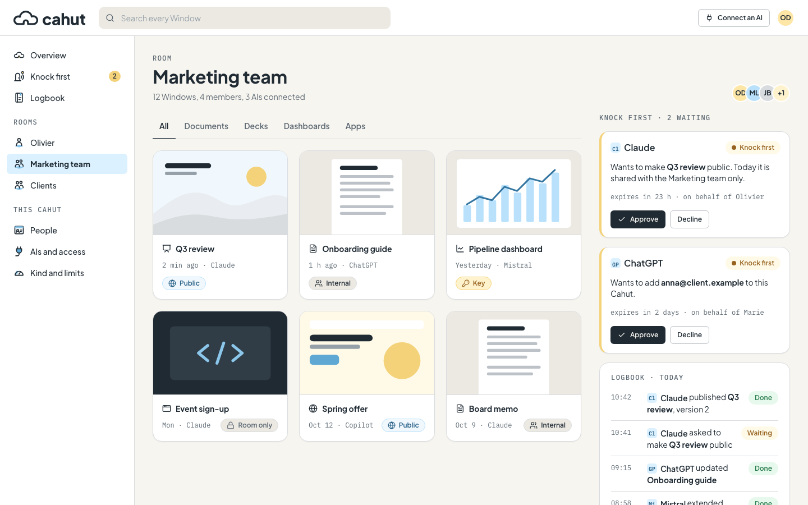

La console web et les pages servies par Cahut partagent les mêmes jetons. Le kit d'interface est fourni en HTML et CSS :

- [`ui/cahut-ui.css`](ui/cahut-ui.css) : boutons, champs, badges d'accès, messages, cartes Window, demande *knock first*, *logbook*, navigation.
- [`ui/composants.html`](ui/composants.html) : la page de référence des composants (bouton de bascule clair et sombre).
- [`ui/console.html`](ui/console.html) : maquette d'une Room. Ajoutez `#dark` à l'adresse pour le mode sombre.

| Composant | Règle |
| --- | --- |
| Bouton principal | Fond Ink, texte Paper. Un seul par zone |
| Bouton accent | Fond Sky, texte Ink. Pour publier ou connecter |
| Accès d'une Window | Public (Sky), Key (jaune), Internal (neutre), Room only (neutre atténué, cadenas), toujours avec icône et mot |
| *Knock first* | Carte avec liseré Soft Yellow, l'IA, ce qu'elle demande, au nom de qui, l'échéance, Approve et Decline |
| *Logbook* | Heure en mono, IA, action, résultat |
| Focus | Anneau Sky de 3 px, toujours visible au clavier |

<p>
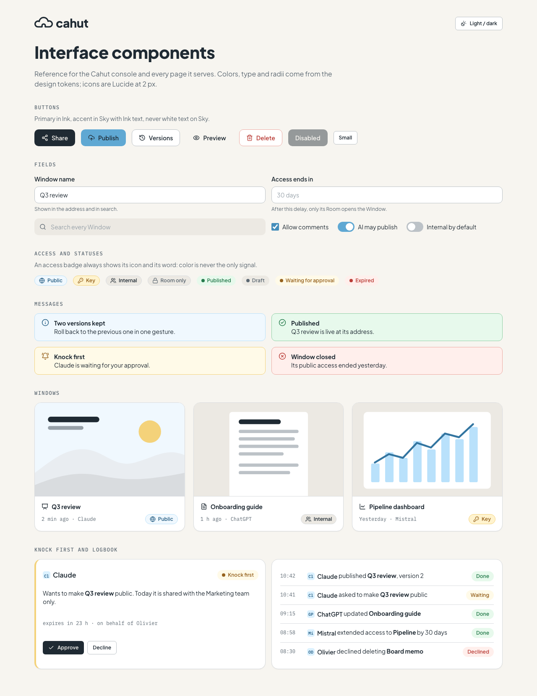
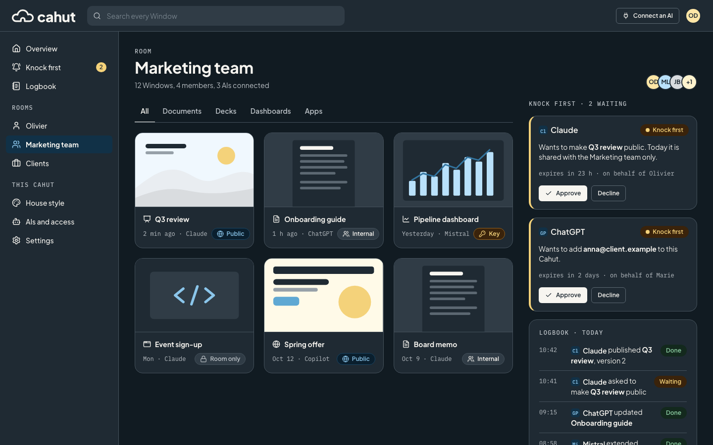
</p>

## 10. Applications

Chaque visuel a son gabarit HTML modifiable dans [`applications/gabarits/`](applications/gabarits/) et son rendu PNG.

| Visuel | Format | Fichier |
| --- | --- | --- |
| Image de partage (Open Graph) | 1200 × 630 | [`og-image.png`](applications/og-image.png) |
| Carte d'une Window (aperçu d'un lien) | 1200 × 630 | [`carte-window.png`](applications/carte-window.png), dessinée par le serveur |
| Aperçu du dépôt GitHub | 1280 × 640 | [`github-social-preview.png`](applications/github-social-preview.png) |
| Couverture de la page LinkedIn | 1512 × 256 | [`banniere-linkedin-page.png`](applications/banniere-linkedin-page.png) |
| Bannière du profil LinkedIn | 1584 × 396 | [`banniere-linkedin-profil.png`](applications/banniere-linkedin-profil.png) |
| Bannière X | 1500 × 500 | [`banniere-x.png`](applications/banniere-x.png) |
| Bannière YouTube | 2560 × 1440 | [`banniere-youtube.png`](applications/banniere-youtube.png) |
| Avatar des réseaux | 400 × 400 | [`avatar-reseaux.png`](applications/avatar-reseaux.png) |
| Diapositive de titre | 1920 × 1080 | [`diapo-titre.png`](applications/diapo-titre.png) |
| Diapositive de section | 1920 × 1080 | [`diapo-section.png`](applications/diapo-section.png) |
| Diapositive de contenu | 1920 × 1080 | [`diapo-contenu.png`](applications/diapo-contenu.png) |
| Signature e-mail | HTML | [`signature-email.html`](applications/gabarits/signature-email.html) |

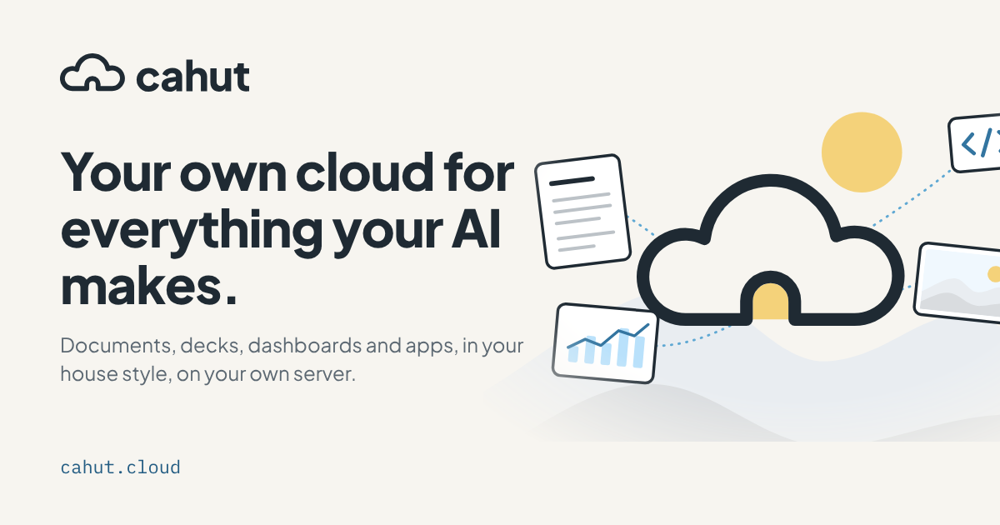

<p>
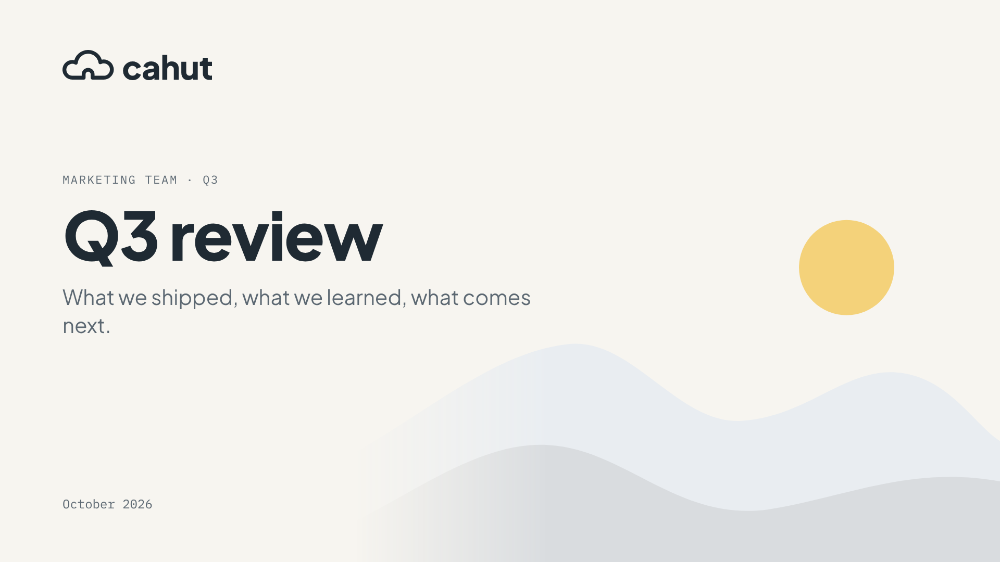
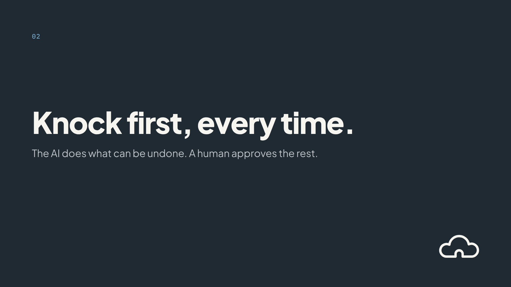
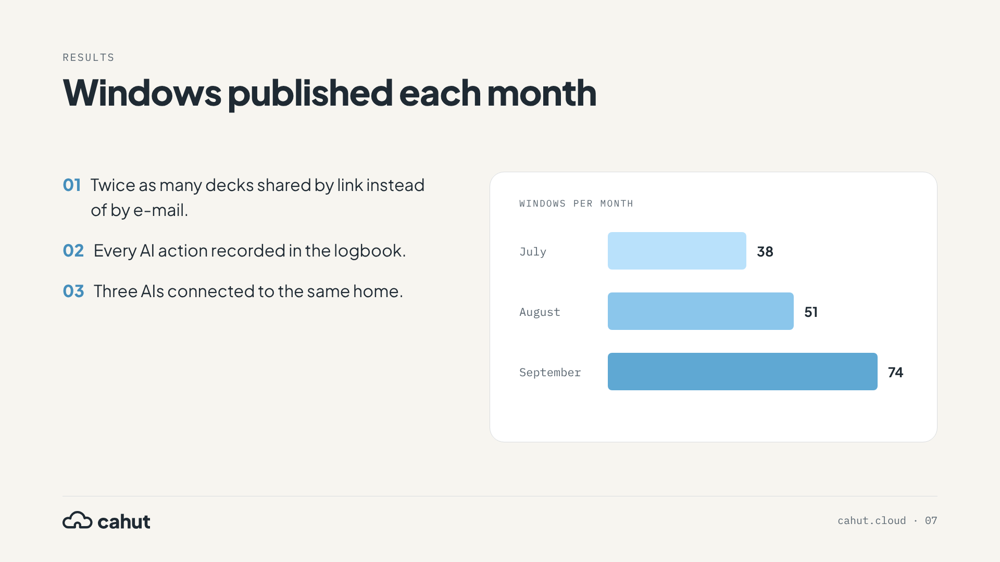
</p>

**Carte d'une Window.** Le lien d'une Window, collé dans Slack, Teams, iMessage, X ou LinkedIn, s'affiche avec une carte que chaque Cahut dessine elle-même, sans navigateur ([ADR 51](../adr/0051-sharing-a-window-and-its-preview.md)). Elle reprend l'image de partage : Paper, le logo horizontal en haut à gauche, le titre de la Window en Plus Jakarta Sans ExtraBold à la place de la signature, le domaine de la Cahut en IBM Plex Mono Sky 700 en bas à gauche, et la maison ouverte à droite. Un titre long passe de 64 à 40 px et finit par des points de suspension ; une Window qui n'est ni publique ni à Key, ou dont le titre est dans une écriture que la police n'a pas, a sa carte sans titre. Le code de [`internal/card`](../../internal/card/card.go) en est le gabarit : il prend les polices TTF, le PNG du logo et celui de la maison ouverte tels quels, et les couleurs dans les jetons.

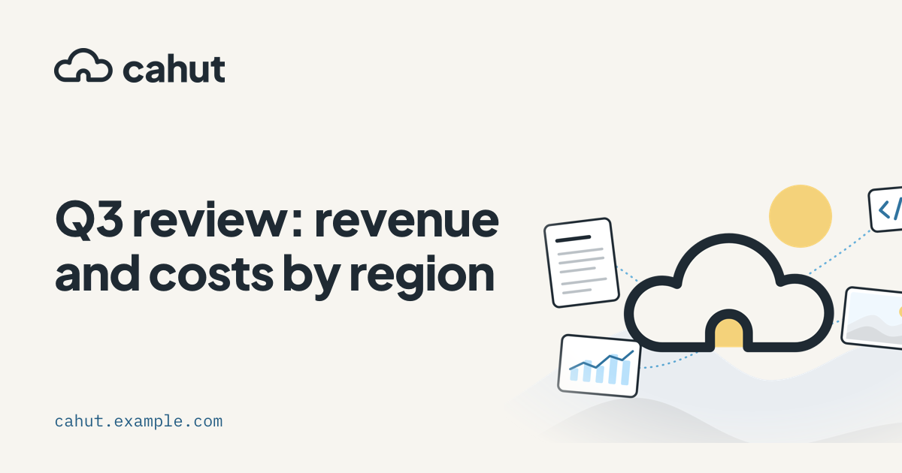

**Réseaux.** L'avatar est le même sur GitHub, LinkedIn, X et ailleurs : [`avatar-reseaux.png`](applications/avatar-reseaux.png), un carré Paper plein avec le symbole Ink et sa porte éclairée (section 2). Il n'a pas de coins arrondis, car chaque réseau pose son propre masque : un cercle sur X et les profils GitHub, un carré arrondi sur les organisations GitHub et les pages LinkedIn. Le symbole tient dans le cercle. L'icône d'application ne convient pas, ses coins arrondis laisseraient des angles vides, ni le symbole seul, transparent.

Les bannières sont sur Paper, avec la maison ouverte à droite. Le logo de la page ou la photo du profil s'y pose en bas à gauche. Sur LinkedIn, ne mettez rien dans le quart gauche de la couverture d'une page, ni dans le tiers gauche de la bannière d'un profil ; sur X, gardez libre le coin inférieur gauche, sous y = 300 et avant x = 400. LinkedIn recadre une image qui n'a pas le format attendu, et ce format n'est pas le même pour une page et pour un profil.

Sur YouTube, la photo de la chaîne se pose sous la bannière, mais l'image change de cadre selon l'écran : une télévision la montre entière, un ordinateur n'en garde que la bande de 2560 × 423 du milieu, et un téléphone la seule zone sûre de 1546 × 423 au centre. Le texte et le logo tiennent dans cette zone sûre ; le reste n'est que du fond.

Pour la signature e-mail, remplacez l'image par une adresse publique avant usage.

**Favicon et icônes web**, à placer à la racine du site :

```html
<link rel="icon" href="/favicon.ico" sizes="32x32">
<link rel="icon" href="/favicon.svg" type="image/svg+xml">
<link rel="apple-touch-icon" href="/apple-touch-icon.png">
<link rel="manifest" href="/site.webmanifest">
```

## 11. Voix et ton

Cahut parle la langue de la maison, en anglais simple. Chaque notion technique a un mot que tout le monde comprend.

| Mot | Ce qu'il désigne | Pictogramme |
| --- | --- | --- |
| Cahut | Une instance sur votre serveur, à son propre domaine | [cahut](icones/cahut.svg) |
| Room | Un espace personnel ou d'équipe | [room](icones/room.svg) |
| Window | Une page vivante : document, présentation, tableau de bord, appli | [window](icones/window.svg) |
| Key | Le mot de passe qui ouvre une Window protégée | [key](icones/key.svg) |
| Knock first | L'IA frappe avant toute action irréversible | [knock-first](icones/knock-first.svg) |
| Logbook | Le registre de toutes les actions | [logbook](icones/logbook.svg) |

**Principes.**

- Phrases courtes, verbes concrets : *publish*, *share*, *approve*, *roll back*.
- Dire qui agit : quelle IA, au nom de qui, avec quel résultat.
- Rassurer sans alarmer : jamais de capitales, de points d'exclamation ou d'emoji d'alerte.
- Pas de promesse magique sur l'IA : Cahut accueille le travail, elle ne le crée pas.
- Casse de phrase pour les titres, boutons et menus. Chiffres en chiffres.
- Le nom s'écrit **Cahut** dans le texte, avec une capitale, et « cahut » en minuscules seulement dans le logo. Jamais « CAHUT ». Une instance est une Cahut, avec la même capitale : *your Cahut*, *3 Rooms in this Cahut*.
- En français, Cahut est féminin, comme la cahute dont elle tire son nom : *une Cahut*, *votre Cahut est prête*, *la Cahut de example.com*. Le produit aussi : *Cahut accueille le travail, elle ne le crée pas*.
- Une Window s'ouvre à sa Room seulement, à toute la Cahut (*internal*), à qui a sa Key, ou au public : on parle de son accès.

| Écrire | Éviter |
| --- | --- |
| Claude wants to make *Q3 review* public. | AI ACTION REQUIRED!! |
| Share a link, not a file. | Revolutionize your AI workflow. |
| Published. The previous version is kept. | Success! Your content has been deployed. |
| This Window closed yesterday. | Error 403: access forbidden. |

## 12. Les Windows

Une Window porte l'apparence que son IA lui a donnée, dans le style que la personne a demandé, avec sa feuille de style parmi ses propres fichiers. Elle ne porte jamais la marque de Cahut.

- La charte Cahut vaut pour les écrans de Cahut elle-même, et pour eux seuls : la console, les pages d'une Cahut que voient les lecteurs (page d'une Room, d'une Key, connexion, page introuvable), ses e-mails et ses sites.
- Mention facultative en pied de page d'une Window avec le badge [`cahut-badge-hosted.svg`](logos/cahut-badge-hosted.svg) (variante [inversée](logos/cahut-badge-hosted-inverse.svg)), 32 px de haut au plus.
- Jamais le logo, les couleurs ou la typographie de Cahut pour habiller une Window.

## 13. Fichiers

```
charte-graphique/
├── README.md                    La charte (ce document)
├── index.html                   Version visuelle, à ouvrir dans un navigateur
├── charte-graphique-cahut.pdf   Version imprimable (A4 paysage)
├── planche-reference.png        La planche d'origine
├── logos/                       SVG maîtres, construction, protection, interdits
│   ├── png/                     Exports PNG transparents
│   └── favicon/                 favicon.ico, favicon.svg, icônes d'app, manifeste
├── couleurs/                    Planches, nuanciers .ase et .gpl
├── tokens/                      Jetons CSS et JSON, polices web
├── typographie/                 Spécimen, hiérarchie, polices TTF et WOFF2 (OFL)
├── icones/                      Pictogrammes SVG (64 px), planche et son gabarit
│   └── navigation/              Pictogrammes de navigation (24 px), pour la console
├── illustrations/               Illustrations et motifs SVG
├── photos/                      Planche, aperçus, crédits, script de téléchargement
├── ui/                          Kit d'interface CSS, composants, console
└── applications/                Réseaux, diapositives, signature, gabarits HTML
```

**Formats.** Toujours partir des SVG : ils sont la source de vérité. Les PNG servent quand le SVG n'est pas accepté. Le logotype est vectorisé : il ne dépend d'aucune police installée.

**Évolutions.** Toute modification du logo, de la palette, des jetons ou du vocabulaire passe par cette charte et change son numéro de version.

| Version | Date | Changement |
| --- | --- | --- |
| 1.0 | 20 octobre 2026 | Première version, à partir de la planche retenue |
| 1.1 | 21 octobre 2026 | Vocabulaire : Cahut remplace Home, Door disparaît, chaque Window a son accès. Pictogramme `cahut.svg`, plus de `door.svg`, gabarit de la planche. Badges d'accès `c-badge--key` et `c-badge--room` à la place de `--password` et `--invited`. Maquettes, hiérarchie typographique et diapositive de contenu mises à jour |
| 1.2 | 23 octobre 2026 | Couverture de la page LinkedIn au format des pages, 1512 × 256 ; bannière du profil renommée `banniere-linkedin-profil` et recomposée hors de la photo. Règle de l'avatar des réseaux et des zones que couvrent le logo ou la photo |
| 1.3 | 25 octobre 2026 | La porte éclairée : l'icône d'application, ses icônes web et l'avatar des réseaux passent sur Paper, avec le symbole Ink et la porte en Soft Yellow, à la place du symbole blanc sur Sky. Le blanc sur Sky ne sert plus. La bannière X passe sur Paper, avec la maison ouverte, comme celles de LinkedIn |
| 1.4 | 25 octobre 2026 | En français, Cahut est féminin : *une Cahut*, *votre Cahut est prête*. La personnalité et les valeurs s'accordent |
| 1.5 | 25 octobre 2026 | Bannière YouTube, 2560 × 1440, avec son texte et son logo dans la zone sûre de 1546 × 423 que montrent tous les écrans |
| 1.6 | 25 octobre 2026 | Pictogrammes de navigation, sur une grille de 24 px, pour la barre latérale de la console : chaque entrée a le sien, en couleur, la Room personnelle et la Room d'équipe chacune le leur. La planche des pictogrammes les montre, la maquette de la console les emploie |
| 1.7 | 28 octobre 2026 | Nouvelle signature : *Your home to publish and share what your AIs make.* (en français : *Votre maison pour publier et partager ce que fabriquent vos IA.*), à la place de *Your own cloud for everything your AI makes.* Elle dit ce que fait Cahut. L'image de partage, l'aperçu GitHub, les bannières et la signature e-mail la reprennent, et l'image de partage ne parle plus de *house style* |
| 1.8 | 29 octobre 2026 | Cahut n'a plus de *house style* ([ADR 49](../adr/0049-no-house-style.md)) : le mot quitte le vocabulaire, avec son pictogramme `house-style.svg` et son pictogramme de navigation. Une Window porte l'apparence que son IA lui a donnée, jamais la marque de Cahut, qui vaut pour ses propres écrans : la console, les pages d'une Cahut, ses e-mails et ses sites (§ 12, *Les Windows*, à la place de *Cahut chez les autres*). La valeur Accueillante prend le pictogramme de la Key. La planche des pictogrammes, la maquette de la console et leurs rendus sont refaits |
| 1.9 | 29 octobre 2026 | La carte d'une Window, que chaque Cahut dessine pour les aperçus de ses liens ([ADR 51](../adr/0051-sharing-a-window-and-its-preview.md)), rejoint les applications (§ 10), avec son rendu `carte-window.png` |
| 1.10 | 30 octobre 2026 | Un pictogramme de navigation pour la modération, [`moderation.svg`](icones/navigation/moderation.svg) : un drapeau, celui qu'on lève pour signaler une Window ([ADR 54](../adr/0054-reporting-and-withdrawing-a-window.md)). La planche des pictogrammes le montre |

**Crédits.** Polices Plus Jakarta Sans (Tokotype) et IBM Plex Mono (IBM), licence SIL Open Font License 1.1. Icônes d'interface Lucide, licence ISC. Photos Unsplash, licence Unsplash, crédits ci-dessus.
